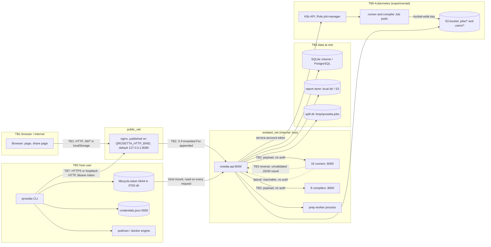

# Test plan for v2.0.0

Version 1, 2026-10-28 (task V0 of the verification campaign). Risks are numbered as in
`risk-register.md` (R1-R30). Task ids: V1-V9 are the verification campaign, A1-A13, B1-B4 and C1 the
overnight polish plan; both plans are in the private notes, and their results will be summarised in
`completion-report.md` (task V9). Section 8, the threat model, is a draft for the owner to check.

## 1. Test items

Quantum Rosetta at version `2.0.0.dev0` on the branch that becomes the v2.0.0 tag: the API
(`rosetta-api/`), nginx and the page (`rosetta-api/static/`), the shared instrument
(`shared/qrosetta_commons/`), the 16 runner and 8 compiler images, the `qrosetta` CLI (`qrosetta_cli/`)
and the release workflow (`.github/workflows/release-images.yml`).

## 2. Scope

In scope, tested:

1. Local mode (Docker Compose) on Linux, with rootless podman 5.x and Docker Compose v2 as provider (the
   reference host: EL10, SELinux enforcing) and with Docker Engine and Compose v2.
2. The CLI: stack commands on Linux; client commands on Linux, macOS and Windows (the CI matrix, Python
   3.11-3.15).
3. The page in current Firefox and Chromium, including the share page and the docs pages.
4. Exports (RO-Crate, report JSON, publication figures and tables) and client-supplied reports.
5. The release workflow, statically (`test_release_workflow.py`, `test_release_manifest.py`) and through
   one rc rehearsal (owner).

Experimental, not tested in this campaign, stated as such in the v2.0.0 release notes unless the owner
decides otherwise (R24):

6. Kubernetes mode (`EXECUTION_MODE=kubernetes`, Rahti). Unit tests of the Job spec and dispatch
   (`test_k8s_dispatch.py`, `test_k8s_job_slots.py`) run in CI; nothing runs against a cluster.
7. Apptainer and Slurm (`scripts/roihu/`).

Out of scope: the cuQuantum GPU path on hosts without an NVIDIA GPU (reported unavailable, which is
tested); the disabled braket and projectq runners; publishing (owner only).

## 3. Test levels and where they run

| Level | What | Where |
|---|---|---|
| Unit and static | `rosetta-api/tests/unit/` (pytest-xdist), type gate (`scripts/check_frontend_types.sh`), parity harnesses, OpenAPI CLI contract, gitleaks | CI on every push |
| CLI | bare `cli` job (Python 3.11-3.15; client half also on macOS and Windows) | CI |
| Integration, live | `tests/integration/` against a running stack; V3 adds a CI job with nginx, API, qiskit, qulacs and cirq, and an E2E smoke test through nginx and `./qrosetta` | locally today; CI after V3 |
| Known answers and metamorphic relations | `GET /selftest`; V4 per-gate table, relabelling, inverse, register split, null effect, cross-mode | live stack |
| Equivalence | `scripts/harness_bench/equivalence.py`, `prep_equivalence.py`, `scripts/adapter_paths/compare_paths.py`, B2 requalification harness | before any change to analysis, preparation or an image |
| Security | V5 (authorization matrix, JWT, rate-limit spoofing, scanners), V2 (headers, XSS), V6 (fuzzing, ReDoS) | in process and against the live stack as a user |
| Failure injection | V7 (fake runners, killed prep worker, spill budget, API restart, clock skew) | in process overnight; on the real stack by people |
| Statistical | V8 (Monte Carlo of false-flag and power figures, p-value calibration, mutation score) | offline, CPU heavy, never beside a timing measurement |
| Exploratory and acceptance | five charters, clean-VM installs, upgrade from v1.0.0, screen-reader and keyboard passes | people (campaign, "For people") |

## 4. Entry criteria

A task starts only when:

1. Its branch is created from `overnight/integration` (or the release branch later), and at that commit
   the unit suite and the type gate pass. The two load-sensitive tests
   (`test_memory_monitor_captures_spike`, `test_circuit_preparation_does_not_block_the_event_loop`) count as
   passing when they pass on a rerun alone.
2. For live tasks (V3 locally, V4, V5): `GET /config` on http://127.0.0.1:8080 answers and `GET /runners`
   lists the enabled runners as available. The task uses the stack as a user only: one job at a time, a
   test account `overnight-<task>-<random>@example.invalid` deleted at the end, no `bypass_limits`.
3. For timing work (B2, B3, V8 timing parts): no image build, scanner or V4/V6/V7/V8 job runs at the same
   time, and the load average is recorded before and after.
4. Scanner and tool images are pinned by digest and mount none of the stack's volumes.

Suspension: a task stops and reports when it would need to start, stop, rebuild or prune the stack, change
a sealed timed window without old-vs-new evidence, or make an owner decision (polish plan, rules 3, 5, 10).

## 5. Exit criteria for v2.0.0

Proposed; the owner confirms. Copied from the verification campaign.

| # | Criterion | Covered by |
|---|---|---|
| E1 | Every MUST in the campaign run, with evidence; 0 open Critical or High defects; every open Medium fixed or listed as a known issue with a workaround in the release notes. | V1-V8 (defects in `defects.md`); V9 maps each to evidence |
| E2 | Unit suite, type gate, gitleaks and a CI integration job green on the tagged commit; images built from the tag, never `-dirty`. | V3 (integration job); C1 (full check of the integration branch); A10 (release checklist); existing CI |
| E3 | OWASP ASVS 5.0 Level 1: every requirement Pass or N/A with a reason; the listed Level 2 chapters (V2, V4, V5, V7, V8, V9, V13, V15, V16) have no Fail without a written accepted-risk entry. | V5 and V2 cover the requirements named in the QA report (JWT, authorization, logout, headers, decompression, generic errors). The full Level 1 checklist has no task tonight: open, owner to schedule |
| E4 | No Critical or High dependency or image vulnerability with a fix available, unless accepted in writing. | V5 (pip-audit, Trivy incl. secrets, triage); A7 (Trivy and Dependabot in CI); A8; B1, B3 |
| E5 | ZAP baseline: no unexplained High or Medium alert. BOLA/IDOR matrix: 100% of id routes, 0 failures. | V5 (ZAP baseline, matrix with coverage assertion); V2 (the header fixes ZAP would flag) |
| E6 | Fuzzing: at least 8 CPU-hours across the harnesses with 0 unexplained crashes or timeouts. | V6 (>= 2 CPU-hours on harness 1 overnight; the remaining hours later) |
| E7 | Known-answer gate table and metamorphic relations pass on every backend, or each failure is a documented upstream defect. | V4 |
| E8 | Upgrade from a v1.0.0 database and clean installs on two distributions succeed from the README alone. | A1 (migrations); people: clean VMs (Fedora/RHEL with rootless podman, Ubuntu LTS with docker) and the upgrade with real data |
| E9 | `qrosetta selftest` PASS on the release images on a reference host. | C1 (on images built from the integration branch); the rc rehearsal (owner, A10 checklist) |
| E10 | axe: 0 serious or critical issues; keyboard-only pass complete. | A12 (axe-core, or a static review if no headless browser); people: keyboard and screen-reader pass |

## 6. Risks to exit criteria

| Risk rows | Exit criterion |
|---|---|
| R1-R3, R5 | E7, E9 |
| R4 | E2, E9 |
| R6 | E8 |
| R7-R9, R11-R15, R27-R29 | E1, E2, E6 |
| R10, R26 | E4 |
| R16, R19-R23, R25 | E3, E5 |
| R17 | E2, E9 |
| R18 | none: proposed as a new criterion ("three fixture crates validate against the Process Run Crate profile at REQUIRED level") |
| R24 | none while Kubernetes mode is experimental |
| R30 | E10 |

## 7. Deliverables

`risk-register.md` and this plan (V0); `defects.md` and session sheets (private notes); per-task reports;
`completion-report.md` (V9), attached to the release.

## 8. Threat model (draft for the owner)

### 8.1 Data flow and trust boundaries

Trust boundaries:

- TB1 browser to nginx. Local mode publishes nginx on `127.0.0.1:8080` unless `QROSETTA_HTTP_BIND`
  names another address; Rahti puts a Cloud Run nginx in front that sets `X-Qrosetta-Client-Ip` with a
  proxy token.
- TB2 nginx to API. The API keys rate limits on the last X-Forwarded-For entry, which nginx appends.
- TB3 API to runners and compilers, both directions. Runners parse attacker-chosen QASM through
  third-party SDK parsers; the API reads their JSON without a schema, size or depth check (R7). Neither
  side authenticates the other, and every runner can reach the API and every other runner on
  `isolated_net`.
- TB4 API to database, report store and spill directory.
- TB5 host user to CLI, engine and the lifecycle token. The token authorises `POST /local/host-load` and
  `?fresh=true` probes.
- TB6 API to the Kubernetes API (Role `job-manager`: create, delete and patch Jobs; read pods and
  events; bound to the namespace's `default` service account) and Job pods to S3.
- TB7 CLI to a remote API (token from `QROSETTA_TOKEN` or `credentials.json`).

### 8.2 STRIDE

S spoofing, T tampering, R repudiation, I information disclosure, D denial of service, E elevation of
privilege. "Unverified" marks a threat read from the code or configuration and not yet tried.

| # | Boundary | STRIDE | Threat | Current control | Gap and risk row |
|---|---|---|---|---|---|
| T1 | TB1, TB2 | S | Forged JWT | HS256 with `algorithms` pinned (`security.py:152`); uid and iat binding; `SECRET_KEY` required outside local mode | guard untested; ephemeral key with more than one worker (R23: V1.9, V5) |
| T2 | TB3 | S | A compromised runner calls `rosetta-api:8000` directly and sets its own X-Forwarded-For, so it chooses its rate-limit key | none: the last entry is the runner's own | R19: V5 rate-limit spoofing from `isolated_net`; owner: internal authentication or per-runner networks |
| T3 | TB3 | T | A compromised runner returns a forged result for its own backend | verdicts attribute the difference to that backend; known answers in `GET /selftest` | only its own backend is affected unless T4 holds (R1, R19) |
| T4 | TB3 | T, I | A compromised runner with the default capability set (`NET_RAW` kept, no `cap_drop`) intercepts API-to-runner traffic on the shared bridge and alters other backends' results | none (unverified: depends on the engine's network backend, rootless podman vs Docker) | R19: owner decision on `cap_drop` and per-runner networks |
| T5 | TB3 | E, D | A compromised runner calls other runners' `/run` past the gate, loading the host during other timed windows unrecorded; or fork-bombs, fills the disk | `RUNNER_MAX_CONCURRENT`=1 per runner; memory limit 1G, CPU quota 1.0 | no `pids_limit`, read-only root or internal authentication (R19) |
| T6 | TB3 | E | From inside `isolated_net` a runner submits jobs with `bypass_limits` (anonymous in local mode) | RUN rate limit 10/min, spoofable (T2) | R19, R20 |
| T7 | TB1 | E, D | Local mode bound to a public address: anyone registers, runs with `bypass_limits`, reads job reports by id; no TLS, so tokens cross the network in clear | default bind is loopback; changing it is an explicit choice | R20: owner decides warn or refuse |
| T8 | TB1 | T, E | A page on another site POSTs a run to a local server without a CORS preflight | CORS limited to localhost origins (does not stop simple POSTs) | R12: V1.3 |
| T9 | TB1 | I | Stored XSS in the main page reads the JWT from localStorage; clickjacked `DELETE /auth/me` | escaping at every innerHTML site (unpinned); CSP on `/share.html` only | R21: V2 |
| T10 | TB1, TB2 | I | Another account reads a saved run, circuit or share-link list; any holder of a job id reads that job's report, also an owned job's | `user_id` filters; owner check on save (403); uuid4 job ids; share tokens stored as SHA-256 | R22: V5 matrix; job ids also appear in nginx and gunicorn access logs (combined format) |
| T11 | TB2, TB3 | I | Raw exception text with container paths in responses and stored reports | generic 500 handler; dispatcher hints stripped | R13: V1.2 |
| T12 | TB2 | D | Crafted reports, chunked bodies, deep expressions, regexes on 1 MB input | 1 MiB body limit (Content-Length only), depth 64, rate limits per address | R14: V1.4, V1.5, V1.13, V6; A4 keys limits by account |
| T13 | TB4 | T, E | A pickle planted in a pre-existing `/tmp/qrosetta-jobs` runs in the API | the API creates the directory; `makedirs(exist_ok=True)` accepts an existing one | R27: V1.11 |
| T14 | TB4 | I | Developer database or reports copied into a locally built image and exported with `qrosetta images save` | `.dockerignore` excludes the root `data` only | R26: V1.10, A13 |
| T15 | TB5 | S | Another local user reads the lifecycle token | token file in a 0700 directory under `$XDG_RUNTIME_DIR` | token recreated under a running stack: notices 404, ignored (R28: V1.12) |
| T16 | TB7 | I | The CLI sends the token to a redirect target, to any `--server`, or over plain http | password refused over plain http to a non-loopback host; credentials 0600 | R25: V1.6 |
| T17 | TB5 | T, E | A crafted image archive applies its own tags on `images load`; a crafted crate ZIP exhausts memory | archive schema, sha256, 16 MiB per member | R25: V1.6, V1.7 |
| T18 | TB6 | T, I | A parser exploit in a Job pod uses the bucket-wide S3 key to read or forge user reports and other jobs' results | no service-account token in pods; payload in env or a pending key | R24: no NetworkPolicy, no per-job credentials; accepted only if Kubernetes mode is experimental |
| T19 | TB6 | E | A compromised API creates Jobs with any image in the namespace | Role limited to Jobs, pods and events | R24 |
| T20 | all | R | A failure or abuse cannot be traced across API, runner and pod logs | job id in some API log lines; per-result timestamps, exit codes, image identity | no request or correlation id; K8s pod logs deleted after 300 s (risk not in the register: proposed as R31 if the owner wants it tracked) |

### 8.3 Questions for the owner

1. Are the trust boundaries above the right ones, in particular TB3 treated as untrusted in both
   directions?
2. For v2.0.0: accept T2-T6 in writing with a note in the release, or harden runners first (a Wave B task
   after B3, with a timing re-measurement)?
3. Local mode on a non-loopback bind (T7): warn, refuse without a flag, or document only?
4. Kubernetes mode (T18, T19): experimental in v2.0.0?
